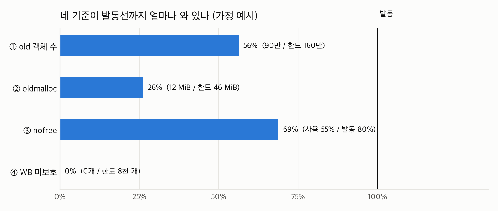
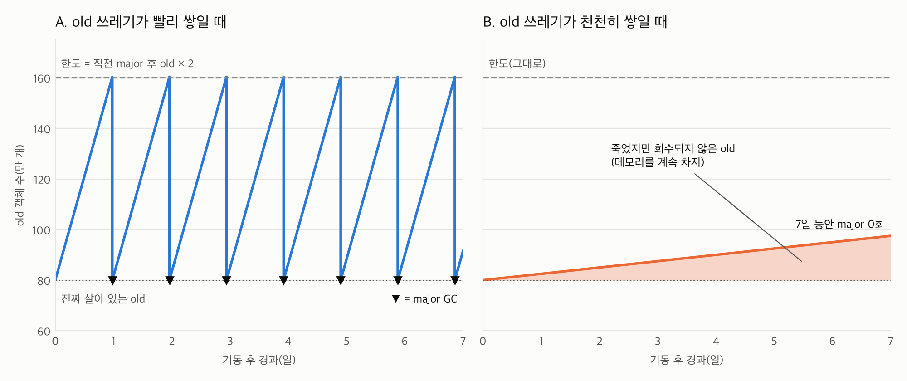

## 이런 상황을 가정해 보자

- Rails + Puma로 돌아가는 API 서버가 있다. 워커 메모리가 **며칠에 걸쳐 조금씩** 오른다.
- 갑자기 튀는 게 아니라, 재시작하고 나면 다시 처음부터 천천히 오른다.
- `GC.stat`을 워커별로 모아 보니 **major GC가 며칠씩 한 번도 안 도는 워커**가 있었고, 그 워커들의 메모리가 가장 많이 올라 있었다.
- 코드를 뒤져 보니 **5분마다 설정 데이터를 통째로 다시 읽어 캐시를 갈아 끼우는** 코드가 있었다. 내용이 같아도 매번 새 객체를 만들고 있었다.
- 내용이 같으면 기존 객체를 재사용하도록 고쳤더니, major GC 횟수가 **시간당 2회에서 0.25회 정도로 줄었다.** 그런데 메모리는 같거나 오히려 낮았다.

여기서 이런 질문이 나온다.

1. major GC가 줄었는데 이거 나쁜 거 아닌가? 청소를 덜 한다는 뜻 아닌가?
2. major GC를 부르는 기준이 여러 개라던데, 왜 다른 기준으로는 안 돌았지?

이 질문에 답하려면 Ruby GC가 어떻게 생겼는지부터 알아야 한다. 이 글은 컴퓨터공학 1학년 정도를 가정하고 바닥부터 정리한다.

> 기준 값과 코드는 [ruby/ruby의 `gc/default/default.c`](https://github.com/ruby/ruby/tree/master/gc/default) (master)를 보고 확인했다. Ruby 버전마다 세부 조건은 조금씩 다를 수 있다.

## 1. GC가 왜 필요한가

C에서는 `malloc`으로 빌린 메모리를 `free`로 직접 돌려줘야 한다. 깜빡하면 메모리가 계속 늘고(누수), 너무 일찍 돌려주면 프로그램이 망가진다.

Ruby는 이걸 대신 해 준다. **더 이상 아무도 쓰지 않는 객체를 찾아서 자동으로 회수하는 장치**가 GC(Garbage Collector)다.

### "아무도 안 쓴다"의 정의: 도달 가능성

GC는 "이 객체를 앞으로 쓸까?"를 예측하지 않는다. 대신 **"지금 손에 쥔 것에서 화살표를 따라가면 닿는가?"**만 본다.

- **루트(root)**: 프로그램이 지금 확실히 쥐고 있는 출발점. 지역 변수, 전역 변수, 상수, 실행 중인 메서드의 스택 등.
- 루트에서 참조를 따라가 닿으면 **살아 있음**, 못 닿으면 **쓰레기**.

```
  [루트: 지역변수, 전역, 상수, 스택 ...]
        │            │
        ▼            ▼
      ┌───┐        ┌───┐
      │ A │──────▶│ B │──────▶┌───┐
      └───┘        └───┘       │ C │
                               └───┘
      ┌───┐        ┌───┐
      │ X │──────▶│ Y │        ← 루트에서 닿는 길이 없음 → 쓰레기
      └───┘        └───┘
```

### Mark & Sweep

방 안의 물건마다 줄이 달려 있다고 생각하면 쉽다. 현관(루트)에서 줄을 따라 손에 닿는 물건에 스티커를 붙이고, 방을 한 바퀴 돌며 스티커 없는 물건을 버린다.

1. **Mark**: 루트에서 출발해 닿는 객체마다 "살아 있음" 표시
2. **Sweep**: 힙 전체를 훑으며 표시 없는 칸을 비움

```
Mark 후:   [A✔][B✔][  ][X ][C✔][Y ][  ][  ]
Sweep 후:  [A ][B ][  ][  ][C ][  ][  ][  ]   ← X, Y 자리가 빈 칸이 됨
```

### Ruby 힙에서 알아 둘 단어

- **슬롯(slot)**: 객체 하나가 들어가는 고정 크기 칸. 대략 40바이트 단위이고, Ruby 3.2부터는 40/80/160... 처럼 크기별로 나뉜 힙에 들어간다.
- **힙 페이지(heap page)**: 슬롯 수백 개를 묶은 덩어리(대략 64KiB).
- **malloc 영역**: 슬롯에 안 들어가는 큰 데이터(긴 문자열 본문, 큰 배열, 해시 테이블 등)는 슬롯 밖에서 `malloc`으로 따로 빌리고, 슬롯에는 주소만 둔다.

```
 슬롯(40B)                 malloc 영역
 ┌──────────────┐          ┌──────────────────────────┐
 │ String 객체   │────────▶│ "500KB짜리 직렬화 데이터 ..." │
 └──────────────┘          └──────────────────────────┘
```

객체 하나가 쓰레기가 되면, **슬롯 한 칸 + 그 객체가 붙잡은 malloc 메모리**가 같이 남는다. 이걸 기억해 두자.

## 2. 세대별 GC: young과 old

살아 있는 객체가 90만 개인데 GC 때마다 90만 개를 다 따라가면 느리다. 그동안 Ruby 코드는 멈춰 있다.

그래서 거의 모든 현대 GC가 쓰는 가정이 있다.

> **세대 가설(generational hypothesis)**: 대부분의 객체는 태어나자마자 금방 죽는다. 한참 살아남은 객체는 앞으로도 오래 산다.

웹 요청 하나를 처리하면서 만든 문자열, 해시, 배열은 응답을 보내면 대부분 쓰레기다. 반대로 부팅 때 읽은 설정, 클래스, 캐시는 프로세스가 끝날 때까지 산다.

그래서 객체를 두 무리로 나눈다.

- **young**: 태어난 지 얼마 안 된 객체. 대부분 곧 죽는다.
- **old**: GC를 여러 번 살아남은 객체. 앞으로도 오래 살 가능성이 높다.

### old가 되는 조건: GC 3번 생존

Ruby 객체에는 나이(age)가 있다. GC에서 살아남을 때마다 1씩 늘고, **3이 되면 old로 승격**된다(소스의 `RVALUE_OLD_AGE 3`).

```
 생성 ──GC 생존──▶ age1 ──GC 생존──▶ age2 ──GC 생존──▶ age3 = OLD
   │                │                  │
   └─ 그 전에 참조가 끊기면 다음 minor GC에서 바로 회수
```

가정한 상황과 연결해 보자. 5분마다 갈아 끼우는 캐시 객체는 그 5분 동안 GC를 3번 넘게 겪는다. 그러니까 **old가 된 다음에 쓰레기가 된다.** 이게 뒤에 나올 사각지대의 출발점이다.

## 3. minor GC와 major GC

| | minor GC | major GC (full GC) |
|---|---|---|
| 무엇을 마킹하나 | **young만** 따라감 | **전부**(old 포함) 처음부터 |
| old 객체 취급 | 확인 안 하고 "살아 있다"고 간주 | 진짜 살아 있는지 확인 |
| 회수 대상 | 죽은 young | 죽은 young + **죽은 old** |
| 비용 | 쌈 (young 수에 비례) | 비쌈 (살아 있는 객체 전체에 비례) |
| 빈도 | 자주 | 드물게 |

이 표에서 제일 중요한 한 줄은 이거다.

> **old 객체가 쓰레기가 되면, 다음 major GC가 돌 때까지 회수되지 않는다.**

minor GC는 old를 아예 안 보기 때문이다. 그리고 major GC는 비싸니까 Ruby는 "정말 필요할 때만 major"라는 방향으로 설계되어 있다.

### write barrier와 remembered set

minor GC가 old를 안 본다고 하면 이런 문제가 생긴다.

```
   old 객체 O (예: 오래 사는 캐시 Hash)
      │
      │  cache[:key] = 새 문자열   ← old가 새로 만든 young을 가리키게 됨
      ▼
   young 객체 Y
```

Y를 가리키는 게 O뿐이면, minor GC는 O를 건너뛰니까 Y가 "아무도 안 가리킨다"고 판단해서 **살아 있는 Y를 지워 버린다.**

이걸 막는 장치가 두 개다.

- **write barrier(쓰기 장벽)**: 객체 안의 참조를 바꿀 때마다 끼어드는 작은 검사 코드. "old가 young을 가리키게 됐나?"를 본다.
- **remembered set(기억 집합)**: 그 검사에 걸린 old 객체 목록. minor GC는 루트와 함께 **이 목록도 출발점으로** 삼는다.

```
 minor GC의 출발점 = 루트 + remembered set(young을 가리키게 된 old 목록)
```

모든 객체에 write barrier가 붙어 있는 건 아니다. 주로 오래된 C 확장이 만드는 객체가 그런데, 이걸 **WB-unprotected(별명 shady)** 객체라고 부른다. GC가 이 객체의 참조가 언제 바뀌었는지 모르니, 오래 산 shady 객체는 **매 minor GC마다 무조건 다시 훑어야** 한다. 이게 네 번째 기준과 이어진다.

## 4. major GC 발동 기준 4가지

### 먼저 구분: "GC를 언제 도느냐" vs "그 GC를 major로 하느냐"

**GC 자체가 도는 때** (대부분 minor):

- 새 객체를 만들려는데 빈 슬롯이 없을 때
- 직전 GC 이후 malloc 순증가가 `malloc_limit`을 넘었을 때 (16MiB 시작, x1.4씩 크고, 최대 32MiB)

**그 GC를 major로 바꾸는 기준**이 아래 4가지다. GC를 하면서 조건을 검사하고, 걸리면 **"다음 GC는 major로"라는 표시**(`gc_needs_major_flags`)를 남기는 구조다.

직전 major가 왜 돌았는지는 `GC.latest_gc_info(:major_by)`로 볼 수 있다. `:oldgen`, `:oldmalloc`, `:nofree`, `:shady`, `:force`(`GC.start` 등 수동 호출) 중 하나가 나온다.

이해를 돕기 위해 어떤 워커의 지금 상태를 이렇게 가정하자.



### ① old 객체 수 (`:oldgen`)

**세는 것**: 지금 old 객체가 몇 개인지(`old_objects`). 이미 죽은 old도 포함이다. minor GC는 old가 죽었는지 모르니까.

**한도**: major GC가 끝날 때, 그때 진짜 살아 있던 old 수 x `RUBY_GC_HEAP_OLDOBJECT_LIMIT_FACTOR`(기본 **2.0**).

```c
// gc_marks_finish() 안, major(full marking)였을 때
objspace->rgengc.old_objects_limit = (size_t)(objspace->rgengc.old_objects * r);  // r = 2.0
...
if (objspace->rgengc.old_objects > objspace->rgengc.old_objects_limit) {
    gc_needs_major_flags |= GPR_FLAG_MAJOR_BY_OLDGEN;
}
```

즉 "직전 major 때보다 old가 **두 배**가 되면, 진짜 살았는지 한 번 전부 확인하자"는 기준이다.

**가정한 워커에서는**: 직전 major 후 old 80만 → 한도 160만. 지금 90만. **70만 개가 더 쌓여야** 발동한다.

참고로 기동 직후에는 기준값이 작아서 금방 두 배가 된다. 그래서 프로세스가 뜬 직후에 major가 몰려서 여러 번 돌고, 기준값이 커질수록 간격이 길어진다.

### ② oldmalloc (`:oldmalloc`)

**세는 것**: `oldmalloc_increase_bytes`. 이름에 old가 붙었지만 실제로는 **"직전 major 이후 Ruby가 직접 malloc한 바이트의 순증가"**에 가깝다.

- Ruby 자신의 할당 함수(`ruby_xmalloc` 계열)로 늘리면 **더하고**, 해제하거나 줄이면 **뺀다**(0 아래로는 안 내려감).
- minor GC에서는 리셋되지 않고, **major GC 때만 0으로** 돌아간다.
- "major 사이에 계속 쌓이는 malloc은 아마 old가 붙잡고 있을 것"이라는 **추정**이라 이름이 old다. old 객체의 malloc만 골라 세는 건 아니다.

**안 세는 것**도 중요하다.

| 안 셈 | 이유 |
|---|---|
| 힙 페이지(슬롯 덩어리) 자체 | 별도 경로로 할당 |
| YJIT 코드 영역 | mmap 등 별도 경로 |
| 스레드 스택 | OS가 할당 |
| C 확장 라이브러리가 직접 부르는 `malloc` | Ruby 함수를 안 거침 |
| jemalloc 같은 할당기 내부의 단편화·캐시 | Ruby는 할당기 속사정을 모름 |

그래서 프로세스 RSS와 이 숫자는 따로 놀 수 있다.

**한도는 스스로 조절된다.**

```
 시작값              : 16 MiB  (RUBY_GC_OLDMALLOC_LIMIT)
 이 기준으로 major   : 한도 x 1.2  (RUBY_GC_OLDMALLOC_LIMIT_GROWTH_FACTOR)
 상한                : 128 MiB (RUBY_GC_OLDMALLOC_LIMIT_MAX)
 다른 이유로 major   : 한도 ÷ 1.02 (16 MiB 아래로는 안 내려감)
```

```c
// major 때, oldmalloc 때문에 돈 게 아니면 한도를 조금 줄인다
objspace->rgengc.oldmalloc_increase_limit =
  (size_t)(objspace->rgengc.oldmalloc_increase_limit / ((gc_params.oldmalloc_limit_growth_factor - 1)/10 + 1));
// (1.2 - 1) / 10 + 1 = 1.02
```

"이 프로그램은 원래 malloc을 많이 쓰네" 싶으면 한도를 올리고, 다른 이유로 major가 돌면 아주 조금씩 내리는 식이다.

**가정한 워커에서는**: 12 MiB / 한도 46 MiB. 한참 남았다.

가정한 상황의 캐시가 여기 딱 걸린다. 5분마다 수백 KB짜리 직렬화 문자열을 새로 만들면, 그게 old가 된 뒤에 버려진다. old 쓰레기의 malloc 버퍼는 major 전까지 해제되지 않으니 oldmalloc이 쭉 쌓이고, 한도에 닿아 major가 돈다. **수정 전 시간당 2회의 major는 대부분 이 기준이었을 가능성이 높다.** 재사용하도록 고치면 이 누적이 사라지니 major가 줄어드는 게 자연스럽다.

### ③ nofree: 빈 슬롯이 부족할 때 (`:nofree`)

**보는 것**: GC를 하고 나서도 **빈 슬롯이 충분히 안 생기는** 경우.

```
 GC 뒤 빈 슬롯 비율 = (전체 슬롯 - 살아 있다고 표시된 슬롯) / 전체 슬롯
 기준: RUBY_GC_HEAP_FREE_SLOTS_MIN_RATIO = 0.20
```

minor GC 뒤 빈 칸이 20%도 안 남으면 대략 둘 중 하나를 한다.

- **힙을 늘린다.** 직전 major 직후(GC 3번 이내)라서 major를 다시 해 봐야 소용없을 때 등.
- **다음 GC를 major로 한다.** "죽은 old가 칸을 차지하고 있을지 모르니 전부 확인해 보자."

```c
if (is_full_marking(objspace) ||
        objspace->profile.count - objspace->rgengc.last_major_gc < RVALUE_OLD_AGE) {
    // 힙을 늘린다
}
else if (swept_slots < min_free_slots * 7 / 8 && ...) {
    gc_needs_major_flags |= GPR_FLAG_MAJOR_BY_NOFREE;
}
```

세부는 버전마다 다르다. 지금 master 기준으로는 크기별 힙마다 따로 판단하고, 20%의 7/8 정도까지 여유를 두는 등의 조건이 붙어 있다. 그래서 전체 평균은 넉넉해도 **특정 크기 힙 하나가 빡빡해서** nofree가 날 수도 있다.

**가정한 워커에서는**: GC 뒤 슬롯의 55%만 사용 중(45%가 빔). 20% 아래로 떨어지려면 한참 남았다. 게다가 비율이라서 힙이 커지면 분모도 같이 커진다.

### ④ WB 미보호 객체 (`:shady`)

**세는 것**: old 취급되는 shady 객체 수(`remembered_wb_unprotected_objects`). 이게 많으면 minor GC가 매번 이것들을 다 훑느라 점점 비싸지니까 "많아지면 major로 한 번 정리하자"는 기준이다.

**한도**: 직전 major 때 shady 수 x 2와 old 수 x 1% 중 큰 값.

```c
objspace->rgengc.uncollectible_wb_unprotected_objects_limit = MAX(
    (size_t)(objspace->rgengc.uncollectible_wb_unprotected_objects * r),               // x 2.0
    (size_t)(objspace->rgengc.old_objects * gc_params.uncollectible_wb_unprotected_objects_limit_ratio)  // x 0.01
);
```

**가정한 워커에서는**: shady 0개 / 한도 8천 개(80만 x 1%). 요즘 Ruby와 주요 gem은 대부분 write barrier를 지원해서, 이 기준은 거의 안 걸리는 경우가 많다.

### 정리

| 기준 | 세는 것 | 한도의 기준점 | 가정한 지금 값 |
|---|---|---|---|
| ① oldgen | old 객체 수 | 직전 major 후 old x 2.0 | 90만 / 160만 |
| ② oldmalloc | Ruby malloc 순증가 | 16MiB 시작, x1.2 / ÷1.02 | 12 / 46 MiB |
| ③ nofree | GC 뒤 빈 슬롯 비율 | 20% | 45% 빔 |
| ④ shady | WB 미보호 old 수 | max(직전 x 2, old x 1%) | 0 / 8천 |

## 5. 사각지대: 천천히 쌓이는 old 쓰레기

네 기준을 다시 보면 공통점이 있다. **전부 "직전 major 때 상태" 대비 상대값**이다.

- ①은 직전 old 수의 **두 배**가 될 때까지 참는다.
- ②는 과거 이력만큼 한도가 **이미 올라가 있고**, 슬롯만 차지하는 작은 old 쓰레기는 **아예 안 센다.**
- ③은 비율이라 힙이 커지면 같이 느슨해진다.
- ④는 해당 객체가 거의 없다.

그래서 이런 패턴이 사각지대가 된다.

> **조금씩, 꾸준히, old가 된 다음에 죽는 쓰레기**



- **A**처럼 old 쓰레기가 빨리 쌓이면 금방 한도에 닿고, major가 돌아서 바닥선까지 깨끗이 내려간다. 톱니 모양이 된다.
- **B**처럼 하루 몇만 개씩 천천히 쌓이면 한도는 저 위에 있는데 old 수는 바닥에서 조금씩만 오른다. major가 며칠씩 안 돈다. 그 사이 주황색 영역, 즉 **죽었지만 회수되지 않은 old**가 계속 메모리를 차지한다.
  - 죽은 old의 **슬롯**은 재사용되지 못하니 힙이 커진다.
  - 죽은 old가 붙잡은 **malloc 버퍼**도 해제되지 않는다.
  - 할당기 입장에서도 "사용 중"인 메모리라 OS에 돌려줄 수 없다.

"major GC가 며칠씩 안 도는 워커의 메모리가 오른다"는 현상이 바로 이 그림이다.

## 6. major가 줄어든 건 좋은 신호일까?

**횟수만 보고는 모른다.** 같은 "major 감소"라도 원인이 둘일 수 있다.

```
 (좋은 경우) 쓰레기를 덜 만든다     → 기준에 걸릴 일이 줄어든다 → major 감소
 (나쁜 경우) 쓰레기는 그대로 만든다 → 기준에만 안 걸린다(사각지대) → major 감소
```

구분하려면 **쓰레기를 만드는 속도**를 직접 봐야 한다.

| 볼 것 | 어떻게 | 좋은 신호 | 나쁜 신호 |
|---|---|---|---|
| 할당 기울기 | `total_allocated_objects` 시간당 증가량 (같은 기동 경과 시간끼리 비교) | 줄었거나 같음 | 그대로인데 major만 줄었음 |
| 승격 기울기 | major와 major 사이 `old_objects` 시간당 증가량 | 거의 평평 | 꾸준히 우상향 |
| old 바닥선 | **major 직후** `old_objects` (진짜 살아 있는 old) | 일정 | 매번 조금씩 높아짐 → GC가 아니라 진짜 누수 |
| oldmalloc 기울기 | major 사이 `oldmalloc_increase_bytes` 증가 속도 | 완만 | 빠름 |
| RSS | 같은 기동 경과 시간끼리 비교 | 같거나 낮음 | 천천히 벌어짐 |

가정한 상황으로 돌아가 보자. 캐시를 고친 뒤 major만 줄어든 게 아니라 **minor GC 횟수도 같이 줄었다면**, 그건 할당량 자체가 줄었다는 간접 증거다. minor GC는 빈 슬롯이나 malloc 한도가 소진될 때 돌기 때문이다. 메모리도 같거나 낮다면 **좋은 경우 쪽**이다.

다만 사각지대는 원래 며칠 단위로 드러난다. 며칠 동안은 승격 기울기와 old 바닥선을 같이 지켜보는 게 안전하다.

처음 질문에 답하면 이렇다.

1. **major가 줄어든 게 나쁜가?** 쓰레기를 덜 만들어서 줄어든 거라면 좋은 신호다. 할당·승격 기울기로 확인한다.
2. **왜 다른 기준으로는 안 돌았나?** 네 기준이 모두 직전 major 대비 상대값이라, 천천히 쌓이는 old 쓰레기는 오랫동안 어느 기준에도 안 걸린다.

## 7. 퀴즈

**Q1.** 직전 major 직후 old 객체가 50만 개였고, 지금은 95만 개다. shady는 0이고, oldmalloc과 빈 슬롯은 여유가 있다. 다음 GC는 major일까?

<details>
<summary>정답</summary>

아니다. ① 한도는 50만 x 2.0 = 100만이고 95만은 아직 아래다. 늘어난 45만 개가 전부 쓰레기여도 major는 안 돈다. 이게 사각지대다.

</details>

**Q2.** 1MB짜리 문자열을 만들고 몇 초 뒤 버리는 작업을 계속 반복한다(GC 3번 전에 죽음). 이걸 문자열이 10분씩 살다가 버려지게 바꾸면 oldmalloc은 어떻게 달라질까?

<details>
<summary>정답</summary>

몇 초짜리는 young일 때 죽어서 minor GC가 회수하고, 해제할 때 `oldmalloc_increase`에서 빠진다. 순증가가 거의 0이다.

10분짜리는 GC를 3번 넘게 살아남아 old가 된 다음에 죽는다. minor GC는 이걸 회수 못 하니 1MB 버퍼가 해제되지 않고, 버릴 때마다 oldmalloc이 약 1MB씩 쌓인다. 결국 ② 한도에 걸려 major가 돈다.

</details>

**Q3.** 배포 뒤 major가 시간당 2회에서 0.2회로 줄었다. 그런데 `total_allocated_objects` 기울기는 그대로이고, major 직후 `old_objects`가 매일 3만 개씩 높아진다. 좋은 신호일까?

<details>
<summary>정답</summary>

나쁜 신호다. 할당량이 그대로니 쓰레기를 덜 만드는 게 아니라 기준에 덜 걸리는 것뿐이다. 게다가 **major 직후에도** old가 오른다는 건, major로도 못 치우는 객체(진짜 참조가 남아 있는 것)가 늘고 있다는 뜻이다. GC 기준 문제가 아니라 코드 쪽 누수(어딘가 계속 쌓이는 Hash나 Array)를 의심해야 한다.

</details>

## 참고

- [ruby/ruby `gc/default/default.c`](https://github.com/ruby/ruby/blob/master/gc/default/default.c): 기본값, `gc_marks_finish`, `gc_sweep_finish_heap`, `gc_reset_malloc_info`
- `GC.stat`, `GC.latest_gc_info` 공식 문서: https://docs.ruby-lang.org/en/master/GC.html
